 <div align="center">

# hardik@dev

**`hardik@dev:~$ ./contributions.sh`**


**`hardik@dev:~$ whoami`**

<table>
  <tr>
    <td align="center" valign="middle" width="50%">
      
    </td>
    <td align="center" valign="middle" width="50%">
      <pre>
USER: Hardik Gupta
ROLE: CSE Undergraduate
FOCUS: Systems Programming, AI/ML
LANGUAGES: C, C++, Python
BUILDING: macMPI
STATUS: Open to SWE / ML opportunities
      </pre>
    </td>
  </tr>
</table>

</div>

---


<div align="center">


[](www.linkedin.com/in/hardikgupta1709)
[](mailto:hardikgupta506@gmail.com)
[](https://leetcode.com/u/hardik_104)
[](https://github.com/Hardikgupta1709)

</div>

---

### About Me

-  B.Tech CSE @ **Manipal University Jaipur** (2024–2028) — CGPA **9.11/10**, Dean's Excellence Award ×3
-  Ex ML Research Intern @ **MIIC Lab, MNIT Jaipur** — ensemble models for cardiac diagnostics at 96%+ accuracy


<br>

###  factz

```bash
hardik@dev:~$ whoami --verbose
-------------------------------------
Fun Fact:            Wrote an MPI-1.1 library from scratch — no libmpi, no shortcuts
Status:              Open to SWE / ML internships
-------------------------------------
```

<br>

###  Tech Stack

**Languages**


**ML / AI**


**Web & Backend**


**Tools & Infra**


<br>

###  Featured Projects

<table>
<tr>
<td width="50%" valign="top">

** [Tat-Sahayk](https://github.com/Hardikgupta1709/Tat-Sahayk)**
AI-powered ocean hazard detection system

`PyTorch` `FastAPI` `PostGIS` `DBSCAN` `React`

- Multi-modal CNN + NLP service classifying coastal hazards from satellite imagery & incident reports — **85% accuracy**, **<100ms** inference latency
- Geospatial hotspot engine (DBSCAN on PostGIS) delivering a **1000× speedup** over brute-force iteration for real-time alerts

</td>
<td width="50%" valign="top">

** [macMPI](https://github.com/Hardikgupta1709/macMpi)**
Production-grade MPI-1.1 library for Apple Silicon

`C11` `macOS/XNU` `kqueue` `pthreads` `CMake`

- Complete MPI-1.1 implementation from scratch — custom process manager, full-mesh Unix Domain Socket comms, out-of-order packet handling
- Multithreaded kqueue-based async engine enabling compute–communication overlap across up to **16 concurrent processes**

</td>
</tr>
<tr>
<td width="50%" valign="top">

** [AI-Powered Research Paper Submission System](https://github.com/Hardikgupta1709/YOUR-REPO-NAME)**
Full-stack submission portal with AI auto-fill

`Streamlit` `GROBID` `Tesseract OCR` `OAuth 2.0`

- AI auto-fill via GROBID + Tesseract OCR extracts metadata from PDFs, cutting manual submission time by **70%** across 21+ fields
- OAuth 2.0-secured Google Drive/Sheets integration for automated, error-free cloud sync

</td>
<td width="50%" valign="top">

** LVH Detection — MIIC Lab, MNIT Jaipur**
Research internship project

`Random Forest` `XGBoost` `Logistic Regression`

- Ensemble model on PTB-XL ECG dataset (21,837 recordings) — **96.01% accuracy**, **99.84% specificity**
- Preprocessing pipeline resolving 60%+ missing values, cutting training time by **40%**

</td>
</tr>
</table>

<br>


</div>

 
