# hardik@dev

### `hardik@dev:~$ ./contributions.sh`

### `hardik@dev:~$ whoami`

<table>
  <tr>
    <td valign="top" width="43%">
      
    </td>
    <td valign="top" width="57%">
      
    </td>
  </tr>
</table>

---

## About Me

- Computer Science student and software developer
- Interested in systems programming, machine learning, and backend engineering
- Building **macMPI** and other software projects

## Tech Stack

<!-- Copy your existing technology badges here. -->

## Featured Projects

<!-- Preserve your existing project descriptions and links here. -->

## Connect

<!-- Preserve your existing contact and professional links here. -->
